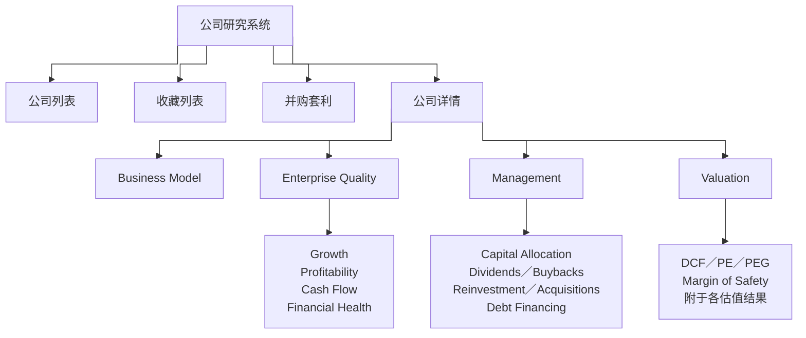

# 公司研究系统 V1 产品需求文档（PRD）

> 基准日期：2026-11-28。本文记录当前实际实现的产品行为，不以历史阶段方案代替现状。已实现功能不代表所有公司、所有期间均有完整数据。

## 1. 产品概述

### 1.1 产品定位

面向进行独立基本面研究的价值投资者，以 SEC 财务披露和原始申报为主要事实依据，结合受原文约束的中文 AI 研究摘要，提供公司筛选、经营质量分析、资本配置研究及可调整假设的估值工具。

财务金额和指标由确定性规则处理，AI用于解释已披露业务信息，不生成财务数值或替代投资者判断。估值结果是研究参考，不是市场报价、可成交价格或买卖建议。

### 1.2 产品目标与核心研究需求

| 研究问题 | 产品目标 |
|---|---|
| 先研究哪些企业？ | 浏览、搜索 SEC 公司目录，维护个人收藏，查看已有财务概览。 |
| 企业做什么、如何赚钱？ | 提供有原始披露依据的中文商业模式解释。 |
| 企业是否增长、盈利、产生现金并保持偿债能力？ | 按可比期间展示历史财务指标和趋势，明确缺失及适用限制。 |
| 管理层如何使用资金？ | 将确定性的资本配置数据与投资、收购、融资研究信息结合展示。 |
| 在个人假设下，企业可能值多少？ | 分别提供 DCF、PE、PEG 结果与固定安全边际参考，不混合成单一结论。 |

### 1.3 V1功能范围

正式页面为公司列表、收藏列表、并购套利和公司详情。公司详情含 Business Model、Enterprise Quality、Management、Valuation 四个业务Tab。

范围以企业经营研究及美元财务数据为主。不提供股票行情、当前股价、市值、实时市场PE、分析师预测、组合收益追踪、自动交易或投资评级。行业PE属于行业相对估值参考，不是个股市场PE。

### 1.4 数据与研究原则

1. 区分原始披露、公式计算、AI摘要和个人估值假设；提供必要来源和期间说明。
2. 缺失、未核准、不适用与真实零值分别处理。缺失显示 `—`，不得为了补齐页面生成零值。
3. 财务期间采用真实报告起止日，尊重非自然年度及52／53周财年，不仅依据年份标签判断可比性。
4. 中间计算保留原始精度，展示时格式化；负值和超过100%的合法结果不得任意截断。
5. 中文解释帮助阅读，专业指标及业务名称保留必要英文；数据限制不能因文案精简而隐藏。

### 1.5 核心文档体系

V1仅维护两份核心设计文档：[PRD.md](PRD.md) 负责产品范围、功能及业务规则；[TDD.md](TDD.md) 负责数据逻辑、技术架构、实现与运维约束。

总体系统数据逻辑图及仍适用的技术决策已经整合至TDD，不再独立维护历史设计和验收文档，也不建立文档归档目录。根目录README、脚本说明、业务代码、测试、维护脚本和数据库迁移继续保留。仍被程序消费的历史机器证据作为测试夹具保留，运行生成的临时报告存放于artifacts，不属于核心设计文档。

## 2. 总体业务架构

### 2.1 业务模块



该图是业务层级，不表示新增路由、独立页面或指标之间的计算依赖。Valuation实际只设DCF与PE & PEG两个Tab。

### 2.2 公司研究流程

1. 在公司列表或收藏中搜索并选择公司；并购套利列表独立提供交易线索及原始公告链接。
2. 进入公司详情，查看基本资料、收藏状态及数据准备状态；后续访问复用已有研究数据。
3. 阅读商业模式，结合企业质量年度／季度指标和趋势，研究增长、资本回报、现金流与财务健康。
4. 查看管理层资本配置总览及五个详细模块，区分资金事实与管理层披露的计划、目的和风险。
5. 进入估值，调整基准及研究假设，分别查看DCF、PE、PEG及安全边际参考。需要最新研究时主动使用更新入口，先确认可能产生的AI费用。

### 2.3 通用展示与交互

| 规则 | 当前要求 |
|---|---|
| 期间选择 | 列表显示最新完整财年或最新独立季度。企业质量使用同一个Annual／Quarterly选择，展示最近10个期间。管理层采用完整年度，估值按其独立基准规则，不被企业质量期间切换改写。 |
| 历史缺失 | 保留历史坐标；缺失不补零、不插值、不跨缺失期间连线；单个有效值可作为独立点展示。已有历史不足时不虚构更早期间。 |
| 最新值 | 顶部指标取所选口径最新报告期间；该期缺失不回退到更早期间冒充最新。PE／PEG的默认EPS回退是明确标示的专门规则，见5.5。 |
| 单位 | 通常金额为百万美元、股数为百万股、每股金额为美元；个别图表明确标为亿美元。比例用百分比，财务比率用倍数。 |
| 格式 | 财务卡片及列表金额保留千分位，通常最多两位小数；图表可保留现有精度。百分比通常两位。估值EPS、PE、PEG、百分比及每股结果统一两位小数；仅改变显示精度。收入明细原始金额可保留必要的更细小数。 |
| 提示 | 指标说明、公式、来源和普通限制优先放入Tooltip；影响计算的错误和数据可靠性警告继续可见。 |
| Tab状态 | 切换已访问的业务／估值Tab时保留现有参数和选择，不因切换重复初始化研究状态。切换公司不得沿用其他公司的财务数据或个人估值输入。 |

## 3. 功能需求

### 3.1 公司列表

**业务目的**：发现研究对象，并对已有财务数据做初步浏览。

- 浏览完整SEC公司目录，按公司名称或Ticker搜索、清空条件、分页及重新加载；每页10条。
- 展示公司名称和代码、Revenue YoY、EPS YoY、Operating Margin、Net Margin、OCF、FCF、Cash、Total Debt、财务期间及收藏操作。
- 默认Annual，可切Quarterly。增长率为同比；Cash和Total Debt为对应期末余额。指标定义见第4章。
- 点击公司进入详情；搜索、分页及期间条件用于恢复列表上下文。收藏操作期间反馈保存状态，失败显示错误。
- 列表浏览、搜索、分页和收藏不启动单家公司财务获取，也不批量补齐未研究公司的财务数据。无已有财务数据的公司仍可存在于目录，指标显示 `—`。
- 不提供全市场财务排名、任意指标筛选、价格筛选或自动推荐。

### 3.2 收藏列表

**业务目的**：维护个人持续关注的公司集合。

- 复用公司列表的搜索、分页、年度／季度财务概览和详情入口，仅展示已收藏公司。
- 收藏按同一公司身份共享：同一公司的不同代码别名不产生不同的财务研究记录或收藏状态。
- 收藏与财务获取相互独立；取消收藏只改变关注状态，不删除财务数据或研究成果。
- 返回收藏列表应保留原列表上下文。不提供自定义分组、持仓金额、成本、收益率或投资组合分析。

### 3.3 并购套利

**业务目的**：提供待核实的收购事件线索，便于进一步阅读公告。

- 展示FMP记录的交易日期、收购方及代码、目标公司及代码、状态和SEC原始公告链接；支持分页及失败重试。
- 当前接入的数据范围为首次取得的有限记录，页面说明当前套餐最多返回5条；分页并不代表已采集完整历史交易。
- 所有记录明确标为“待核实”。FMP日期不等于已核验的签约、交割或最终完成日期。
- 不自行解析8-K，不由AI确认交易，不计算并购价差、年化套利收益、完成概率或买卖建议；不接入当前股价。
- 与公司详情中的Acquisitions不同：后者是公司年报Item 7的AI研究结果，二者不可视为同一事件全集。

### 3.4 公司详情

#### 3.4.1 公共区域

**业务目的**：围绕同一公司组织研究并明确资料状态。

- 展示公司名称、Ticker、CIK、行业、投资者关系链接及财务资料更新时间；支持收藏、取消收藏和返回原列表。
- 默认打开Business Model；四个业务Tab按2.1组合。
- 提供明确的“更新数据”确认：会更新SEC财务数据、最新年报及两类AI研究，可能产生费用；运行时展示更新状态，失败或部分失败时保留已有有效结果。
- 初次研究可能需要准备数据；资料未就绪、正在获取及无可用内容均需有反馈，不把加载状态当成零值。
- 不承诺一次更新就能补齐全部历史披露或所有缺失指标。

#### 3.4.2 Business Model

**业务目的**：帮助投资者理解企业做什么、如何赚钱及已披露的增长方向。

| 项目 | 功能与规则 |
|---|---|
| 研究内容 | 依次回答“公司做什么？”“公司怎么赚钱？”“未来有哪些增长机会？”。结合实际业务板块说明产品服务、客户、付费方、收费机制和收入来源。 |
| 披露依据 | 使用最新适用10-K的Item 1；展示财年、申报日期、生成时间及SEC原始年报链接。 |
| 分类 | 区分披露事实和管理层观点／计划。缺乏原文依据时说明无法确认或保留空内容，不补写盈利机制。 |
| 兼容与更新 | 旧版摘要可兼容展示并提示，不在阅读时自动重新生成。更新中保留旧摘要及其原始报告期间。 |
| 展示边界 | 不逐条显示SEC证据折叠入口，不代表原文证据已删除。不增加竞争优势、护城河、独立风险分析或AI投资评级。 |

#### 3.4.3 Enterprise Quality

**业务目的**：从增长、盈利回报、现金流和偿债能力评估企业经营质量。

四个模块共用年度／季度选择，指标和图表采用2.3的历史、缺失及最新值规则。

| 子模块 | 展示内容与交互 | 当前边界 |
|---|---|---|
| Growth | Revenue、Revenue YoY、Diluted EPS、EPS YoY；Revenue及EPS的3Y／5Y CAGR；营收历史趋势、Revenue／EPS同比趋势。末尾提供默认折叠的Revenue Breakdown。 | CAGR为完整年度研究参考，季度不使用年度CAGR冒充季度值。 |
| Revenue Breakdown | 按原披露动态项目及表格展示收入金额、年度比较和最新年度YoY，保留原始10-K来源。 | 当前是最新年报的年度原表，通常包含近三年比较；实际列数以披露为准，不随Quarterly切换变成季度明细。当前正式展示为表格，不另承诺收入饼图或分部趋势图。 |
| Profitability & Capital Returns | Gross Margin、Operating Margin、Net Margin、ROE、ROIC；并排展示利润率趋势和ROE／ROIC资本回报趋势，支持全部对比或单指标查看。 | 季度ROE不输出；季度ROIC采用单季度报表口径，不年化、不使用TTM。ROIC缺失不影响其他曲线；不展示旧ROIC历史依据大表。 |
| Cash Flow | OCF、CapEx、FCF、FCF Margin、Cash Conversion Ratio；现金流趋势与现金流质量趋势，支持对比及单指标查看。 | 季度现金流采用独立季度，不能直接展示累计现金流；不自动估计维持性资本支出。 |
| Financial Health | Cash + Marketable Securities、Total Debt、Net Debt、Current Ratio、Debt / Equity、Interest Coverage；现金与债务趋势、财务比率趋势，支持对比及单指标查看。 | 期末余额与期间损益不可混用；利息费用或债务未核准时相关指标缺失。 |

不恢复Advanced Quality Metrics、Management & Risks或Owner Earnings独立模块，不新增ROIC依据表、额外风险列表及估值图表。

#### 3.4.4 Management

**业务目的**：判断管理层如何投资、融资及分配现金，区分已发生事项、管理层计划与风险。

固定展示顺序：Capital Allocation → Dividends → Buybacks → Reinvestment → Acquisitions → Debt Financing。总览使用最新完整财年，五个详细模块保持年度口径，历史图最多展示近10个完整财年；不存在全局季度管理层分析模式。

| 模块 | 展示与交互 | 业务规则与边界 |
|---|---|---|
| Capital Allocation | 同一容器切换“经营现金流”和“总资金流向”，默认前者；仅显示最新完整财年标记，无历史年度选择。 | 是已识别资本配置研究，不是逐笔资金归属证明；见下方视图规则。 |
| Dividends | DPS、DPS YoY、Cash Dividends Paid、Dividend Payout Ratio及DPS历史图。 | 已宣告每股股息与实际现金支付分开；宽口径总股息不能直接用于普通股支付率。 |
| Buybacks | 股票回购金额、Diluted Shares YoY、期末普通股数、Buyback / FCF；可在回购金额与稀释平均股数趋势间切换。 | 不将授权额度当作实际支出，不用回购金额推算回购股数；股数变化不完全由回购决定。 |
| Reinvestment | CapEx、CapEx / OCF、CapEx / Revenue及CapEx历史趋势；AI总结保留投资方向与项目、目的、未来计划、投资风险四类。 | 前三条主要投资信息默认可见，其余可展开；不删除保存内容。CapEx、R&D、租赁及其他义务须保留不同财务性质，不重复介绍收购。 |
| Acquisitions | 收购对象、披露交易对价、收购目的、交易日期、披露状态及相关说明。 | 区分现金、股票、承债及交割调整；现金加承债不称为完整交易成本。未披露目的不推测，日期精度和状态以申报时点为准。 |
| Debt Financing | AI融资活动、资金用途、重要条款、融资风险；年度债务发行和偿还现金流指标。 | 未用授信／商业票据计划不等于已融资；一般公司用途不自动归因于收购或项目；不重复分红和回购明细。 |

**经营现金流视图规则**：

- 将四项核心支出及扣除后余额与OCF比较，指标定义见4.4；中心展示OCF，图例展示中文名称、金额及占比，颜色与桑基图相同用途保持一致。
- 必要字段完整、OCF为正且支出不超过OCF时使用环形图；核心支出超过OCF时使用横向比例条，保留真实超额比例和负余额，提示覆盖不足。
- 核心字段缺失时仅展示已识别金额／比例，不计算余额、不强制绘制100%环形图；OCF非正或缺失时不计算比例。
- 余额不代表实际留存现金，不纳入债务、金融资产买卖，不暗示支出逐笔由OCF提供。

**总资金流向视图规则**：

- 左侧来源经资金汇总连接右侧用途，节点及流线金额来自已识别年度现金流；两侧占比统一以资金汇总金额为分母，OCF占比仅保留在Tooltip辅助参考。
- 来源优先按经营现金流、债务融资、股票发行、金融资产回收、资产出售、其他来源、动用原有现金、汇率影响排列；用途按资本支出、收购及相关投资、回购、股息、还债、金融资产投资、其他投资／融资支出、现金增加排列；仅展示实际存在的节点。
- 来源和用途完整勾稽时，两侧未舍入占比分别合计100%。不为凑足100%补零或强制归一化。
- 现金动用或增加取自现金余额变化，不将未识别差额当作现金储备；汇率影响是勾稽项，不是实际融资收入。
- 未识别差额单独标示；不能可靠形成平衡图时保留数据不完整提示和简洁的已识别内容。不得暗示某笔债务融资用于某项具体支出，也不重复计入FCF。

AI内容继续保留报告期、申报日期及顶部SEC原始报告入口，不恢复逐条Evidence折叠展示；缺失的总结不得替代确定性财务金额。

#### 3.4.5 Valuation

**业务目的**：将个人经营和资本成本假设转化为可检查的估值参考，提供不同方法的独立结果。

- 仅有DCF和PE & PEG两个Tab，默认DCF；PE与PEG纵向展示并共用EPS选择。切换Tab保持本次参数和方法状态。
- DCF提供基准及税率选择、FCFF方法切换、增长率、行业WACC及永续增长假设；显示五年FCFF和折现表、终值、EV构成、计算公式、股权桥接及每股结果。
- 股权桥接表保留“项目、SEC财报金额、估值调整／结果、操作”四列；七项估计可点击编辑并恢复默认，确定性融资债务及租赁明细不增加编辑操作。
- PE、PEG提供参数区、合理PE和每股估值结果及公式说明；各自恢复默认。默认选择和恢复对共用EPS的影响见5.5。
- 每项估值结果下复用安全边际两行五列表格；不新增独立安全边际Tab。
- 参数变化实时重算；输入不会改变原始财务金额。本次页面假设尚未形成完整的长期研究记录保存能力，刷新页面可能丢失临时输入。
- 不提供详细预测页面、三情景、敏感性矩阵、独立Owner Earnings估值、自动均值估值或市场价格对比。完整业务规则见第5章。

## 4. 财务指标字典

### 4.1 通用约定

下表按正式页面及其估值输入整理。**原始字段**来自披露或经同范围确定性取数，不是AI估计；**衍生指标**按公式计算；**研究估值量**包含默认假设或用户判断。

- `A`：完整年度；`Q`：独立季度；`T`：适用的最近十二个月；`E`：相应报告期末余额。某字段具有底层数据不等于所有业务都会展示全部期间。
- 表内比例公式以小数表达，页面百分比显示再乘100%；倍数不乘100%。正分母及缺失规则按各行执行。
- A/Q的损益与现金流使用同一完整期间。Q2/Q3允许可靠累计值转换；符合期间及范围一致条件时可推导Q4，但不能对累计EPS或平均股数做机械差分。
- 表内“披露值”表示无需另算公式；可靠完整D&A、毛利和债务等存在明确取值／汇总规则，不能把名称近似的字段直接相加。

### 4.2 原始财务字段与取值

| 英文名称／中文含义 | 研究用途与所属模块 | 输入及取值方式 | 口径、期间和限制 |
|---|---|---|---|
| Revenue／营业收入 | 衡量规模；列表增长、Growth、DCF | 本期收入披露值 | A/Q；DCF可用T。不同收入范围不拼接。 |
| Gross Profit／毛利 | 毛利率输入；Profitability | 优先披露值；否则同期收入减销售成本 | 同一申报、期间及币种，A/Q；缺成本不补零。 |
| Operating Income／营业利润 | 经营盈利、利息保障、NOPAT；Profitability、Financial Health、DCF | 披露营业利润，作为EBIT代理 | A/Q，DCF可用T；不是税前利润加利息，不默认包含非经营投资收益。 |
| Net Income／净利润 | 盈利率、ROE、现金转化；企业质量 | 净收益／亏损披露值 | A/Q；母公司归属与合并范围必须匹配用途，不任意替换。 |
| Common-shareholder Income／普通股股东可得净利润 | 普通股股息支付率；Dividends | 经核准的普通股股东利润披露值 | A；不能无依据用合并净利润替代。 |
| Diluted EPS／稀释每股收益 | 每股盈利、增长和相对估值；Growth、PE、PEG | 对应期间直接披露；T须有可靠可比独立期间组成 | A/Q/T；不直接对累计EPS做差分，不因年度值存在就推算Q4。 |
| Basic / Diluted Weighted-average Shares／基本、稀释加权平均股数 | 股份变化研究；Buybacks及估值来源参考 | 期间披露值 | A/Q；不是期末股数，不将年度平均值伪装为Q4。历史稀释均数不自动作为估值当前股数。 |
| Common Shares Outstanding／期末普通股数 | 流通股规模与每股估值参考；Buybacks、DCF | 实际适用日期普通股披露值 | E；多类别不重复汇总，不含库存股；需显示实际日期，不保证涵盖全部潜在稀释。 |
| OCF／经营活动现金净额 | 现金产生能力与资金基准；列表、Cash Flow、Management、DCF | 对应期间经营现金流披露值／可靠独立期间转换 | A/Q，DCF可用T；已经包含实际经营资产负债变动。 |
| Cash PP&E CapEx／现金固定资产资本支出 | 现金再投资规模；Cash Flow、Reinvestment、DCF | 购置物业、厂房、设备的现金支出 | A/Q/T，通常非负；不包含全部收购、无形资产、融资租赁新增资产等经济再投资。 |
| D&A／完整折旧与摊销 | EBIT法FCFF输入；DCF | 优先完整合计；否则仅在范围完整且互不重叠时汇总折旧、摊销 | A/Q/T；独立折旧不等于D&A，含Other混合项不可直接采用；附注舍入量可标记近似。 |
| Income Tax Expense／所得税费用 | 历史税率输入；ROIC、DCF | 同期所得税费用／收益披露值 | A/Q/T按用途；一次性税项不自动正常化。 |
| Pretax Income／税前利润 | 历史税率分母；ROIC、DCF | 对应范围的税前利润披露值 | A/Q/T；非正时不自动使用历史有效税率。 |
| Interest Expense／利息费用 | 偿债覆盖、OCF法利息调整；Financial Health、DCF | 经核准的期间利息费用 | A/Q/T按用途；不以净利息收入或实际现金付息替代，资本化及非现金利息仍需研究。 |
| Cash and Cash Equivalents／现金及现金等价物 | 流动性、净债务及超额现金参考；列表、Financial Health、DCF | 期末现金余额 | E；不包括另列证券；同报告日匹配，不默认全部属于超额现金。 |
| Current Marketable Securities／流动有价证券 | 可动用金融资产参考；Financial Health、DCF | 与现金分列、范围核准的流动证券金额 | E；“流动”不保证全部一年内到期，不与重叠投资重复相加。 |
| Current Assets / Liabilities／流动资产、流动负债 | 流动比率；Financial Health | 期末披露值 | E；不直接把其差额认定为经营NWC。 |
| Equity / Consolidated Equity／股东权益、合并权益 | ROE与ROIC资本输入 | 匹配利润范围的权益／含少数股东权益合并金额 | E；ROE与ROIC口径不同。不得仅因某一个权益字段为负就替代完整资本校验。 |
| Short / Long-term Debt／短期、长期有息债务 | 债务结构；Financial Health、DCF参考明细 | 经核准的借款、商业票据及流动／非流动债务组成 | E；区分账面值、票据面值、组合标签及一年内到期部分，不重复计数。 |
| Finance / Operating Lease Liabilities／融资、经营租赁负债 | 租赁及融资研究；ROIC、DCF | 核准的当前／非当前／合计披露 | E；融资租赁是否已纳入债务必须明确；经营租赁处理见5.4。 |
| DPS／普通股每股已宣告股息 | 每股分红；Dividends | 当期直接披露的每股宣告额 | A/Q中有可靠直接披露才用；当前管理层以A展示。不由现金股息除股数估算。 |
| Dividends Paid／实际现金股息支付 | 股东现金回报；Dividends、Capital Allocation | 优先普通股现金支付；否则可展示披露总额并说明范围 | A；总额可能含优先股或其他分配，不能直接视为普通股专属支付。 |
| Stock Repurchases／普通股回购现金支出 | 股东回报；Buybacks、Capital Allocation | 当期实际现金支出 | A用于管理层；不同于授权、剩余额度或回购股数。 |
| Debt Issuance / Repayments／债务发行、偿还现金流 | 融资活动；Debt Financing、Capital Allocation | 完整年度可靠汇总及独立组成 | A；不是期末债务余额、授信额度或融资租赁本金付款的替代值；汇总与分项不重复。 |
| Capital Allocation Other Flows／其他资本配置现金流 | 资金来源用途；Capital Allocation | 普通股发行、收购及相关投资付款、证券购入／回收、资产出售、其他投资／融资、汇率及现金变化原披露值 | A；混合项保留实际范围，净额不冒称纯发行或纯企业收购；不可据差额创造留存现金。 |
| Revenue Breakdown／收入明细金额 | 收入组成；Growth | 最新年报原表的动态行、年度金额及同比 | 年度原始比较期间；不假设固定分部结构、不相加总项和组成项。 |
| Bridge Reference Amounts／股权桥接原始参考 | 非经营资产和索偿；DCF | 长期投资、少数股东权益、优先股、已确认索偿等披露参考 | E；账面余额不自动等于经济价值，完整条件见5.4；不把候选披露机械汇总。 |

### 4.3 企业质量与列表的衍生指标

| 英文名称／中文含义 | 公式及输入 | 研究用途／所属模块 | 期间、口径及限制 |
|---|---|---|---|
| Revenue YoY／营收同比 | 本期Revenue ÷ 可比上年同期Revenue − 1 | 增长；列表、Growth | A/Q；基期须为正、期间可比，Q比较去年同季度。 |
| EPS YoY／稀释EPS同比 | 本期EPS ÷ 可比上年同期EPS − 1 | 每股盈利增长；列表、Growth | A/Q；基期为正；需核准同拆股及披露口径，不推测拆股调整。 |
| Revenue CAGR 3Y / 5Y／营收复合增长 | `(期末Revenue / n年前Revenue)^(1/n) − 1`，n=3或5 | 长期增长；Growth及DCF增长参考 | A；需n+1个连续完整年度，正值且口径可比，季度不展示。 |
| EPS CAGR 3Y / 5Y／EPS复合增长 | 同上，将Revenue换为Diluted EPS | 长期每股盈利增长；Growth、PEG | A；全段EPS为正并通过跨年可比性核查。负值、缺年、未核准拆股比较均缺失。 |
| FCF CAGR 3Y / 5Y／FCF复合增长 | 同CAGR式，将Revenue换为FCF | DCF增长参考 | A；首末期为正、连续且可比。中间FCF非正时最多保留数学参考，不自动填预测增长。 |
| Gross Margin／毛利率 | Gross Profit ÷ Revenue | 业务盈利；Profitability | A/Q；收入须为正。 |
| Operating Margin／营业利润率 | Operating Income ÷ Revenue | 经营盈利；列表、Profitability | A/Q；收入须为正，允许亏损。 |
| Net Margin／净利率 | Net Income ÷ Revenue | 综合盈利；列表、Profitability | A/Q；收入须为正，允许亏损。 |
| ROE／净资产收益率 | 年度Net Income ÷ 平均期初期末股东权益 | 权益回报；Profitability、Justified PE参考 | A；两个权益余额须为正且利润归属匹配。Q不输出。回购、低权益及一次性损益可能扭曲回报率。 |
| FCF／自由现金流 | OCF − Cash PP&E CapEx | 现金创造；列表、Cash Flow及管理层比例分母 | A/Q；DCF历史参考可用T。不是完整FCFF，也不是全部可分配现金。 |
| FCF Margin／自由现金流利润率 | FCF ÷ Revenue | 收入现金转化；Cash Flow | A/Q；收入须为正，允许负值及超过100%。 |
| Cash Conversion Ratio／利润现金转化率 | OCF ÷ Net Income | 账面利润的现金支持；Cash Flow | A/Q；净利润须为正，允许负现金流及超过100%。 |
| Cash + Marketable Securities／现金及有价证券 | Cash + 经核准、不与现金重叠的流动证券 | 流动性；Financial Health | E；需与同期披露范围勾稽，不在缺证券时仅以Cash冒充合计。 |
| Total Debt／有息债务总额 | 经核准的流动有息债务 + 非流动有息债务，剔除明确包含的融资租赁 | 债务负担；列表、Financial Health | E；包含可靠借款／商业票据，不重复组合标签；不以总负债、面值替代，不把缺项补零。 |
| Net Debt／净债务 | Total Debt − Cash | 净融资负担；Financial Health | E；不扣短期或长期投资，允许负净债务。与ROIC专用融资债务不同。 |
| Current Ratio／流动比率 | Current Assets ÷ Current Liabilities | 短期偿付参考；Financial Health | E；分母须为正，倍数展示。 |
| Debt / Equity／债务权益比 | Total Debt ÷ Equity | 杠杆参考；Financial Health | E；权益须为正，倍数展示；不用ROIC融资债务替代。 |
| Interest Coverage／利息保障倍数 | Operating Income ÷ Interest Expense | 利息偿付覆盖；Financial Health | A/Q；利息为可靠正费用，营业亏损可为负；零利息不输出无穷大；金融企业不适用。 |

### 4.4 管理层衍生指标与资金比例

| 英文名称／中文含义 | 公式及输入 | 用途／所属模块 | 口径与限制 |
|---|---|---|---|
| DPS YoY／每股股息同比 | 本期DPS ÷ 可比上年同期DPS − 1 | 分红变化；Dividends | 完整年度展示，基期须为正；不以历史单季或累计差分替代直接披露DPS。 |
| Diluted Shares YoY／稀释股数同比 | 同期披露本期稀释平均股数 ÷ 同申报可比上期股数 − 1 | 股份变化；Buybacks | 当前管理层按A；需同期间、同拆股口径，基期须为正。不能等同回购减少股数。 |
| Dividend Payout Ratio／股息支付率 | 普通股现金股息 ÷ 普通股股东可得净利润 | 分红可持续性；Dividends | A；净利润须为正，现金股息须核准为普通股范围；只有总股息时缺失。 |
| Buyback / FCF／回购占自由现金流 | 普通股回购现金支出 ÷ 同财年FCF | 回购资金压力；Buybacks | A；FCF须为正且有可靠来源，超过100%不截断。 |
| CapEx / OCF／资本支出占经营现金流 | 同期CapEx ÷ OCF | 投资强度；Reinvestment | A；OCF须为正。 |
| CapEx / Revenue／资本支出收入比 | 同期CapEx ÷ Revenue | 投资强度；Reinvestment | A；收入须为正，不将R&D与现金CapEx混为同一金额。 |
| OCF Core Spending Ratio／核心支出占OCF | 对应核心现金支出 ÷ OCF | 经营现金流覆盖；Capital Allocation | A；OCF须为正；四项为CapEx、回购、股息、收购及相关投资，混合范围沿原披露。 |
| OCF Remainder／扣除核心支出后余额 | OCF − CapEx − 回购 − 股息 − 收购及相关投资 | 核心支出覆盖；Capital Allocation | A；四项均有效才算，允许负值；不是实际留存现金，不包含全部投融资活动。 |
| Total Funds／资金汇总金额 | 桑基图已识别来源金额之和，并与用途总额勾稽 | 总资金流向；Capital Allocation | A；可能包含动用原有现金、净额披露及单列汇率影响，不等于OCF或Revenue。 |
| Total Funds Share／占总资金比例 | 对应来源或用途金额 ÷ Total Funds | 资金构成；Capital Allocation | A；完整勾稽时来源、用途各合计100%；不按两侧分别强制归一化；金额方向与原始符号另保留。 |

### 4.5 ROIC报表参考口径

**所属模块与用途**：Profitability & Capital Returns，用于比较经营收益与投入资本，不是经济利润、竞争优势或未来回报保证。

| 指标 | 实际公式／输入 | 口径与限制 |
|---|---|---|
| Historical Effective Tax Rate／历史有效税率 | 同期所得税费用 ÷ 同期税前利润 | ROIC按实际年度或单季度税率；税前利润须大于零，异常税率不静默截断。 |
| NOPAT／税后营业利润 | Operating Income × `(1 − 历史有效税率)` | 用历史有效税率代理经营税率；保留一次性税项，不额外假设亏损税盾。DCF的研究税率选择另见5.2。 |
| Financing Debt／含融资租赁融资债务 | 核准的有息借款及融资租赁，不重复包含关系 | ROIC及DCF融资债务参考；不同于4.3的Total Debt。 |
| Invested Capital／投入资本 | 合并权益 + Financing Debt − Cash − 已核准流动金融投资 | 使用含少数股东权益的合并权益；不扣长期金融投资，保留商誉；不将经营租赁或研发资本化。 |
| Average Invested Capital／平均投入资本 | `(期初投入资本 + 期末投入资本) / 2` | A用年初年末，Q用季初季末；两个资本值均须大于零。不以期末值代替平均值。 |
| ROIC／投入资本回报率 | NOPAT ÷ Average Invested Capital | A及Q分别计算；Q为单季度、不乘4、不使用TTM。经营亏损可有负ROIC，超过100%不截断；不因单独权益为负直接拒绝，而校验最终资本。 |

必要输入缺失、未核准、期间不兼容、有效税率小于0或大于100%、资本非正时不输出常规ROIC，并保留原因；金融企业不适用。每期独立，某一年或季度缺失不拖累其余期间；十年／十季度覆盖率不保证完整。

### 4.6 估值研究指标索引

| 指标 | 含义、用途及输入 | 公式与规则位置 |
|---|---|---|
| Estimated ΔNWC／经营营运资金变化估计 | 经营资产负债变动现金影响及必要经营现金增量；A/T，可能为部分参考 | 5.2；不是流动资产减流动负债，不以缺项补零。 |
| FCFF／企业自由现金流参考 | 企业层面预测基准；A/T或用户正常化输入 | 5.1—5.2；不能把FCF或Owner Earnings直接等同FCFF。 |
| Forecast FCFF / PV / TV / EV／预测、现值、终值、企业价值 | 未来五年现金流及折现 | 5.3。 |
| Common Equity Value / Intrinsic Value per Share／普通股股权价值及每股价值 | EV和适用非经营资产、债务、索偿、股数 | 5.4；参数齐备仍属于研究估值。 |
| Historical ROE Median／历史ROE中位数 | 最近五个完整财年的有效ROE，作为长期ROE参考 | 5.6；有效值不足五期提示，不自动补足。 |
| Retention / Payout Ratio／留存及派息比例 | Justified PE中由长期增长和ROE推导的假设比例 | 5.6；不是4.4基于现金分红的实际股息支付率。 |
| Fair PE / Fair Value／合理PE及每股估值 | EPS、行业或研究PE、长期参数或PEG | 5.6—5.7；PE和PEG分别输出，不平均。 |
| Margin of Safety / Target Buy Price／安全边际及参考买入价 | 每股估值与固定折扣比例 | 5.8；无当前股价输入，不自动给出买卖判断。 |

## 5. 估值业务规则

### 5.1 DCF基准与方法选择

| 项目 | 当前业务规则 |
|---|---|
| 基准期间 | 默认最新TTM；可选择最新完整财年或手动输入正常化FCFF。损益和现金流必须属于对应同期间，不将季度或年初至今数据直接当TTM。 |
| 默认FCFF方法 | 在当前基准、税率和研究输入下，优先有效正FCFF的EBIT Method；EBIT不可用于估值而OCF有效时采用OCF Method；均不可用时保留缺失／不适用，可手动输入。不会用固定公司名单决定默认方法。 |
| 主动选择 | 用户选择方法后，即使更换期间或参数，也不自动切换。恢复默认重新按可用性判断。不会静默以OCF结果填到EBIT方法中。 |
| 手动基准 | 用户输入正FCFF及非空研究依据；不设置无依据默认值，不自动将Owner Earnings结果接入。 |
| 更新与恢复 | 参数变化即时重算；有统一恢复默认，适用组成输入支持恢复其默认参考。手动金额仅覆盖研究假设，不改财务事实。 |

### 5.2 FCFF及税率、营运资金

**EBIT Method**：

```text
NOPAT = Operating Income × (1 − 研究Tax Rate)
FCFF = NOPAT + 完整D&A − Cash PP&E CapEx − Estimated ΔNWC
```

EBIT、D&A、CapEx、ΔNWC可分别手动调整。D&A和CapEx不得为负；ΔNWC可为负。D&A必须完整，不能采用独立折旧或混有Other的金额替代。缺失组成不自动补零。

**OCF Method**：

```text
FCFF ≈ OCF − Cash PP&E CapEx + Interest Expense × (1 − 研究Tax Rate)
```

沿用现有受期间和范围约束的近似计算，不将净利息收入或现金付息直接代替Interest Expense。OCF可能包含非经营利息及投资分配，未全部剔除；下方另加回现金及投资可能产生重复计价风险，必须提示。

**研究税率选择**：

- 确认美国注册企业时默认21%的美国联邦法定税率简化参考；非美国或身份不明不自动套用。
- 可切换TTM历史有效税率，沿用4.5历史税率公式但使用完整TTM税费、税前利润；即使FCFF选完整财年，所选“TTM有效税率”仍是TTM研究参考，不自动改称年度有效税率。
- 非美国／无法确认注册地时，默认尝试有效税率；不可用则保留缺失。手动研究税率须在0%—100%。
- 历史有效税率须有可靠同期间输入、正税前利润，结果在0%—100%；异常不截断。21%不含全部州税、海外税和抵扣影响；有效税率也不等于边际税率。

**Estimated ΔNWC**：

```text
必要经营现金增量 = (本期Revenue − 对应上期Revenue) × 2%
Estimated ΔNWC = −已纳入经营资产负债变动的现金影响合计 + 必要经营现金增量
```

优先完整清洗值，再采用有依据的近似或部分估计；部分值用于初步研究时保留未纳入项目及遗漏风险。采用现金流量表法，资产负债表仅辅助核对；排除非经营投资、所得税变动、有息债务、融资租赁、资本支出应付款、收购付款和单独估值特殊索偿，混合项目不能可靠拆分时不强行纳入。缺少必要经营现金增量或存在重大冲突时不自动产生有效FCFF。

EBIT法不额外加回融资利息，不重复扣除已排除的非经营收益，不再扣一次必要经营现金增量。EBIT已含SBC费用，本公式不再加回或再次扣除SBC；股数尚未完整处理所有潜在稀释。两种方法的现金CapEx都不能代表全部经济再投资，租赁、特殊索偿与正常化仍有限制，方法切换不等于所有重复计价问题已解决。

### 5.3 增长、折现和终值

| 参数 | 默认政策与用户操作 | 缺失及限制 |
|---|---|---|
| 未来五年FCFF增长 | 默认Historical FCF Growth，取最近五个完整财年间隔的CAGR；可改Historical Revenue Growth，公式见4.3；同时提供3Y参考。允许手动修改并恢复默认。 | 5Y需6个连续年度点，3Y需4点；历史FCF含非正年度时不自动采用。重大波动／CapEx变化提示，不设置人为折扣或固定5%回退。 |
| WACC | Damodaran美国行业Cost of Capital；默认按项目配置的精确SIC匹配 → 已配置合理近似 → 美国非金融企业整体参考。可选择行业、手动输入及恢复默认。 | 必须确认适用的非金融分类才能用整体回退；金融及身份不明不机械回退。匹配是研究近似，不是公司的实际资本成本；显示行业、依据、数据日期及来源。 |
| 永续增长率 | 确认美元名义现金流时默认2%，以长期通胀目标作成熟阶段实际增长约0%的简化参考；可调整并恢复默认。 | 不代表企业必然可持续增长，仍需再投资。非美元不自动套用。 |

当前简单模式使用同一个增长率预测五年，不提供每年独立参数输入或自动衰减路径：

```text
FCFF(t) = FCFF₀ × (1 + g_forecast)^t，t = 1…5
PV(t) = FCFF(t) / (1 + WACC)^t
Terminal Value = FCFF(5) × (1 + g_terminal) / (WACC − g_terminal)
PV(Terminal Value) = Terminal Value / (1 + WACC)^5
Enterprise Value = 五年PV合计 + PV(Terminal Value)
终值现值占比 = PV(Terminal Value) / Enterprise Value
```

- 基准须为正，增长率须大于−100%且结果有限；不对负基准机械应用增长率。
- 预测与折现分开：基准和增长率有效时，即使WACC缺失，也显示五年预测FCFF；折现现值、终值和EV保留缺失。
- WACC须大于0%、小于100%；永续增长率须大于−100%并严格小于WACC。预测期末FCFF非正时不适用普通永续模型。
- 保留未来五年及终值折现表、EV价值构成、通用公式及实际金额代入。终值是第5年末对后续永续现金流的价值，不是第6年单年FCFF。
- 预测期末稳定经营及持续再投资是模型适用前提；当前页面不单独正常化终值现金流，也不提供额外稳定期确认流程。

### 5.4 股权价值桥接及七项默认估计

仅改变股权调整不改变原始EV。通用关系为：

```text
Common Equity Value
= EV + Excess Cash + Non-operating Investments
  − Financing Debt − Applicable Lease Adjustments
  − Noncontrolling Interest − Preferred Claims − Other Material Claims

Intrinsic Value per Share = Common Equity Value / Applicable Shares
```

金额采用百万美元、股数采用百万股，两者相除得到美元／股。

| 可编辑项目 | 默认取值与输入 | 限制与交互 |
|---|---|---|
| Excess Cash／超额现金 | `Max(0, Cash − TTM Revenue × 2%)` | 现金与营收需为适用公司、同期可靠输入；2%是研究假设，非SEC事实。经营现金需求高于现金余额时提示，公式结果为零；金融企业不自动套用。 |
| Short-term Investments／短期有价证券 | 符合独立非经营性证券范围的可靠公允价值 | 不与现金等价物重叠，不默认将所有短期投资均当可加回资产；无主观统一折扣。 |
| Long-term Investments／其他长期投资 | 可靠公允价值优先，否则可靠账面价值近似 | 仅在资产范围可确认时默认；自动参考不保证覆盖全部长期投资，不代表投资收益已从经营价值完全剔除。 |
| Noncontrolling Interest／少数股东权益 | 可靠公允价值优先，否则经范围核对的账面价值近似 | 核对总额与可赎回组成；不能重复加总或仅凭缺标签认定零。当前部分默认依赖已核对的特定申报，并非所有公司均已自动核准。 |
| Preferred Claims／优先股索偿 | 公允价值优先，否则可靠账面索偿近似；当前默认索偿扣减 | 需确认发行主体、证券性质和重叠范围；已扣索偿不得再次加入其全部转换股数。无可靠结构化条件时手动估计或缺失；不提供复杂自动转换定价。 |
| Other Material Claims／其他重大索偿 | Adjusted Book Value（调整后账面价值法）：同报告日、同申报范围内，已识别且符合条件的已确认未清偿负债小计 | 可含诉讼罚款和解应计负债、经确认特殊税务性质的非流动应计税负债、有可靠依据的养老金缺口；不机械加上未确认税收利益。小计不是完整索偿总额，未量化事项继续提示；已知重复或范围冲突会阻止采用。当前养老金缺口自动取数仍不足。 |
| Applicable Shares／估值股数 | 最新适用时点实际普通股数 | 不用历史稀释均数自动替代，不含库存股；多类别需范围一致、不重复。尚不等于完整潜在稀释后的股数，可手动覆盖并恢复默认。 |

**确定性项目与防重复计量**：

- 总融资债务采用经核准、包含融资租赁的Financing Debt账面参考，不改变Financial Health中的Total Debt定义。短期债务、长期债务和融资租赁只作为组成明细，不能再独立扣一次。
- 经营租赁继续作为经营成本，不额外扣除同一经营租赁负债；本版不支持完整租赁资本化估值。
- 同一现金／证券资产、少数权益总额／组成、债务／融资租赁、优先股索偿／转换股份不能重复计量；已经反映于预测现金流或其他调整的义务不能再重复扣除。
- 第二列展示有效SEC参考及必要组成，详细日期和来源放Tooltip；第三列显示最终采用的默认或手动金额。七项通过“编辑”进入数值输入，结束编辑后恢复普通展示并实时重算；可恢复默认，无逐项确认、弹窗或强制研究依据。
- 确认无该项或用户明确输入零，与缺失严格区分；负的资产加回、负索偿及非正股数不是有效普通输入。
- 当前桥接存在待填写项、必要融资债务／股数缺失、公司或报告日不一致、重大已知范围冲突时，不强行输出每股结果。即使采用已识别索偿小计并得到结果，也只属于条件性研究参考，需保留未纳入事项说明。
- 负股权价值可保留模型金额及含义说明；当前正式DCF结果不输出非正股权的每股估值，不据此产生参考买入价。
- 估值假设仅保留在本次页面状态，不自动保存为长期研究记录；重载财务资料后需要重新核对参考金额与期间。

### 5.5 PE与PEG共用EPS

- 默认优先有效正的最新TTM Diluted EPS；TTM缺失或非正时，采用最新完整财年的有效正EPS，并在说明中明确财年和回退原因；两者均无有效值时保持缺失。
- 支持TTM、实际财年、Manual三种选择，手动不设默认EPS。用户主动选择后不再自动回退，恢复默认时重新判断。
- 不使用未经核准的累计EPS相减；历史股数拆分和期间可比性不足时不强行构造TTM。
- 两个估值模块共用同一EPS。恢复PE默认时也重置共用EPS、PE方法、行业与PE参数，同时保留PEG自身增长和Target PEG；恢复PEG默认时重置共用EPS、PEG增长选择和Target PEG，保留PE自身参数。
- EPS非正或缺失时，PE、PEG每股估值均缺失；其他参数输入缺失不以0显示。

### 5.6 PE Valuation

所有方法的每股估值统一为 `Fair Value = EPS × Fair PE`，要求EPS和PE均为有效正值；该公式不在其他章节重复定义。

| 方法 | 合理PE的确定方式 | 默认与适用限制 |
|---|---|---|
| Industry PE（默认） | Damodaran美国盈利企业整体滚动PE：Aggregate Trailing PE for profitable firms | 不用普通算术平均PE或Forward PE。复用项目SIC精确／近似行业映射，可手动选行业及改PE；无法可靠匹配时缺失，不回退全市场PE。属于行业相对估值。 |
| Justified PE | 见下式 | 适用于成熟稳定增长假设，不机械用于高速增长企业。 |
| Manual PE | 用户输入的合理正PE | 不设置无依据固定默认值；缺失或非正不输出。 |

```text
Retention Ratio = g / ROE
Payout Ratio = 1 − g / ROE
Fair PE = Payout Ratio × (1 + g) / (Ke − g)
```

Justified PE默认ROE为最近五个完整财年窗口内有效ROE的中位数，g为2%，Ke为所选Damodaran行业Cost of Equity，不得以WACC替代Ke。有效ROE不足五期仍可形成现有有效值的中位数并提示不足；完全缺失则缺失。异常高回报、非正值、低权益和历史波动需提示，不自动剔除或修正成固定数。

计算需满足ROE > 0、g ≥ 0、g < Ke且g < ROE，参数均有效。可手动调整ROE、g、Ke并恢复默认；派息比例是模型推导假设，不要求与历史现金分红率相同。

### 5.7 PEG Valuation

```text
Fair PE = Target PEG × EPS Growth Rate的百分数值
Fair Value使用5.6统一的EPS乘PE公式
```

例如EPS增长率15%与Target PEG=1对应15倍PE；这里使用15而非0.15参与PEG乘法。

- 默认增长率取历史5Y Diluted EPS CAGR，可切3Y或手动预期增长率；CAGR定义及连续、正值、可比性规则见4.3。
- Target PEG默认1.0，可手动调整及恢复默认。没有理论依据的增长率上限或自动折扣。
- EPS增长率、Target PEG及EPS均须为正；历史CAGR为负或零虽可能有数学值，也不能形成有效PEG估值。
- 历史亏损、异常低基数、重大波动、回购、稀释及一次性损益会扭曲增长，应提示；无法核准时不填固定增长率。
- PEG=1是经验相对估值规则，不是严格内在价值结论，不与PE或DCF自动平均。

### 5.8 Margin of Safety

```text
参考买入价 = 对应方法每股估值 × (1 − 安全边际比例)
```

DCF、PE、PEG各自在结果下展示固定20%、30%、40%、50%四档，两行五列表格；不再提供可编辑安全边际、默认30%状态或独立安全边际Tab，也不重复展示每股估值。

每股估值变化实时更新四档价格，统一两位小数；估值缺失、非正或非有限时显示 `—`。四个比例是研究参考，不保证防止损失，不与市场价比较、不自动判断买卖。

## 6. V1功能边界

### 6.1 当前正式实现

- SEC公司目录、公司搜索与分页、独立收藏及公司详情研究。
- Business Model中文摘要；企业质量四模块；管理层资本配置双视图与五个详细模块。
- 年度／独立季度财务指标、适用的年度／季度ROIC，以及估值适用的TTM／完整年度参考。
- 简单DCF、两种FCFF方法、七项股权调整默认估计与手动覆盖、三种PE方法、PEG和固定安全边际参考。
- 并购套利线索列表及原始来源链接，交易仍待核实。

### 6.2 保留能力但不作为正式前端功能

| 能力 | 当前边界 |
|---|---|
| Owner Earnings | 独立前端已移除；后台、已有研究记录及被其他模块复用的输入仍保留。不作为本版正式估值方法。 |
| Management & Risks／Item 1A | 保留摘要提取及历史研究能力，当前四个业务Tab不恢复旧模块。没有正式独立Risks或护城河模块；投资／融资相关风险仍属于对应管理层研究内容。 |
| DCF详细预测、CAPM及资本结构辅助计算 | 底层仍保留能力，当前正式估值页面未接入这些交互；不能把有计算能力写成已上线页面。 |
| 其他质量指标 | 部分财务输入、类型或计算仍保留，不恢复Advanced Quality Metrics、ROA卡片、经济商誉等旧分类或占位内容。 |

### 6.3 未实现或不承诺

- 自动估计Maintenance CapEx、Owner Earnings独立折现、Owner Earnings接入FCFF，以及完整正常化营运资金／再投资模型。
- 公司专属市场WACC、实时CAPM、股价／Beta／市场市值接入、PE／PEG／DCF结果自动融合。
- DCF年度／TTM之外独立“正常化自动基准”、详细预测页面、三情景、敏感性矩阵、独立终值正常化输入及完整估值研究持久化。
- 全部公司完整十年／十季度覆盖、自动修复所有历史债务与D&A、完整养老金缺口、全部索偿经济价值及复杂可转换证券自动定价。
- 独立风险研究、护城河评级、AI投资结论、8-K并购正文自动解析及并购套利定价。
- 多用户研究协作、权限管理、投资组合、交易、收益追踪及自动买卖提示，不作为本版已交付能力。

### 6.4 已知方法限制与验收关注点

1. 历史ROE、ROIC、CAGR、D&A、利息、融资债务及股权调整覆盖可能不同；展示缺失不一定是计算错误。
2. FCF只覆盖当前现金PP&E定义的资本开支；EBIT法与OCF法均存在经济再投资、特殊索偿、租赁和SBC处理限制。
3. OCF法的非经营收益尚未完全清洗；EBIT法避免了其中部分问题，但不能因此将全部估值调整视为完整核准。
4. 交易日期、收购对价、股数及财务金额必须结合实际报告日和归属范围阅读；AI披露状态不是实时交易状态。
5. 历史增长、行业资本成本、账面价值近似与默认比例都是研究参考，不保证未来经营或估值准确性。
6. 产品验收需覆盖：年度／季度与估值基准切换、最新期间缺失、真实零、负数及超过100%、历史断线和孤立点、AI旧资料保留、费用确认、用户选择不被自动覆盖、恢复默认、债务／租赁／权益／股数防重复计量，以及不同公司状态隔离。

本文作为后续PRD维护基准。TDD完成前继续保留现有历史文档；本次不通过文档编写改变当前产品行为。
