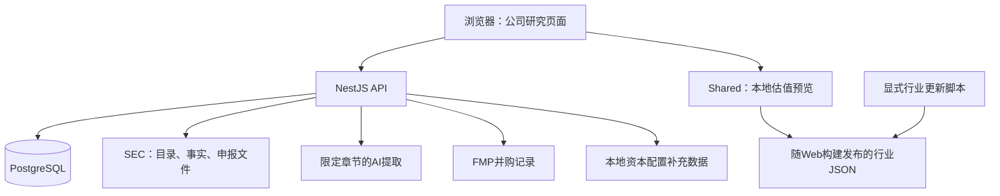
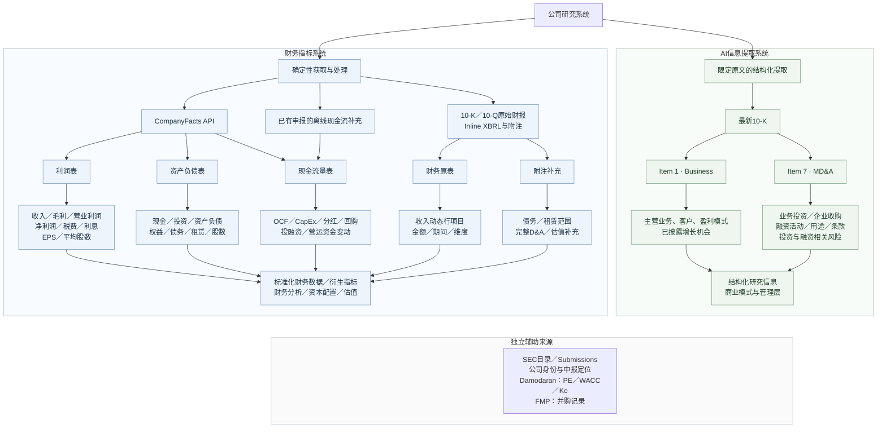
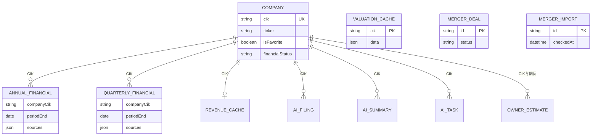
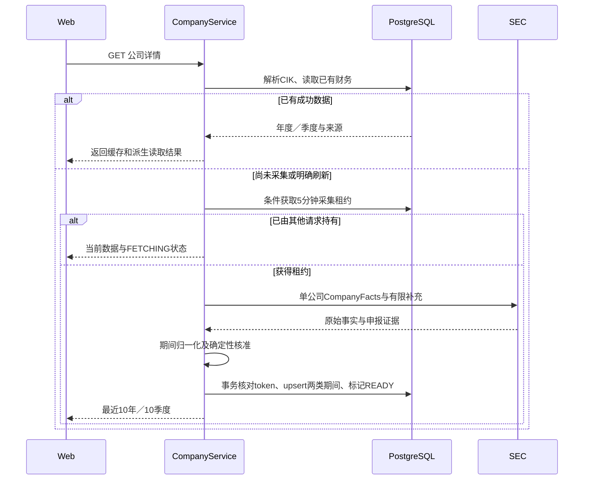
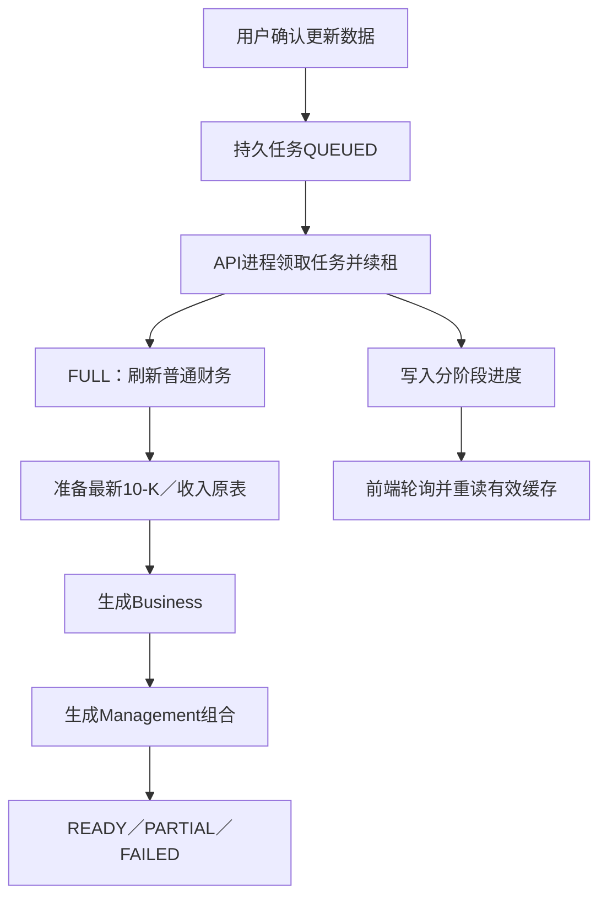
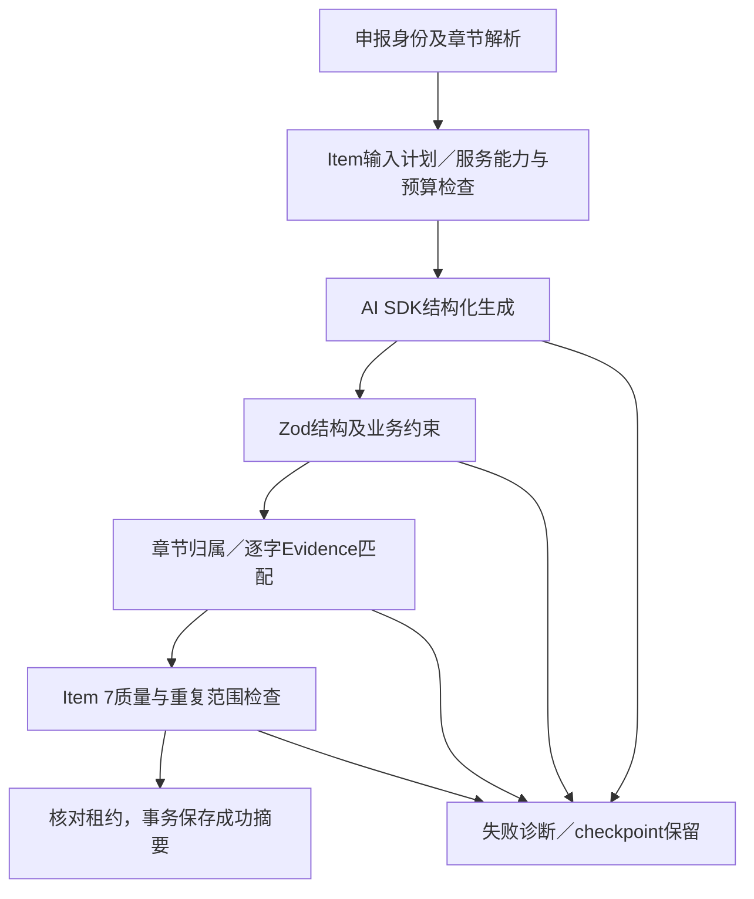

# V1 技术设计文档（TDD）

本文以当前仓库的实际实现为基准，与 [PRD](PRD.md) 共同构成 V1 核心设计文档。PRD 规定产品行为、指标定义与估值政策；本文说明系统如何获取、核准、计算、保存和展示这些数据。代码定位链接用于追溯，不表示相关模块的所有能力都已接入正式页面。

## 1. 系统概述与设计边界

### 1.1 技术栈与部署单元

| 单元 | 当前技术 | 职责 |
|---|---|---|
| Web | React 19、TypeScript、Vite 6、React Router 7、Ant Design 6、Ant Design Charts 2 | 路由、研究页面、图表、参数交互和共享引擎的本地估值预览 |
| API | Node.js ≥22.12、NestJS 11、TypeScript | 外部数据访问、SEC解析、财务归一化、核准、持久化和AI任务 |
| Shared | 无框架依赖的TypeScript包 | API契约、财务与估值计算函数、版本及数据状态 |
| 数据库 | PostgreSQL、Prisma 6.19 | 公司、年度／季度财务、独立估值缓存、收入原表、AI研究和保留的个人研究记录 |
| 外部数据 | SEC、Damodaran、FMP；配置的OpenAI-compatible模型服务 | 财务事实、行业参数、并购记录及限定章节的文本提取 |

采用 npm workspaces，只有根 `package-lock.json`。Web 与 API 分别构建、分别部署，共享包必须先构建。浏览器通过同源 `/api` 访问后端，不直接访问 SEC、FMP 或模型服务。

### 1.2 不可混淆的边界

- **目录与财务采集分离**：公司列表、搜索、收藏只读完整公司目录与数据库；禁止触发 CompanyFacts 获取或全市场财务预取。
- **公司身份与别名分离**：以10位CIK作为持久身份，Ticker用于路由和检索；同CIK别名共享财务记录及收藏状态。
- **事实与研究假设分离**：SEC原始值、核准输入、系统估值默认值、用户覆盖值与计算结果分别保存于相应数据结构中。
- **财务计算与AI分离**：金额和指标由确定性程序取得与计算。AI只解释提供的财报文本，不能产生财务基准或替代缺失值。
- **共享计算与数据访问分离**：Shared不得引入NestJS、Prisma、网络访问或凭据。Web调用共享估值函数不等于在前端重新实现SEC归一化。
- **缺失与零分离**：`null`、未核准、不适用、异常、真实零有不同含义；不以显示数字为目的放宽核准。

### 1.3 总体运行架构



此图为运行依赖，不是完整请求时序。行业脚本访问Damodaran；AI请求由API发出。未引入Redis、独立队列服务、微服务或专门的前端状态管理框架。

## 2. 总体系统数据逻辑

下面整合原总体系统数据逻辑图，保留两条主线和辅助来源；不展开计算公式与逐字段依赖。



**范围说明：** Item 1A后台仍参与部分管理层生成／组合流程，但独立Risks及旧Management & Risks不属于当前正式前端功能，故不作为主分支绘制。FMP并购记录不是系统自行解析8-K的结果。部分基础读取器接受20-F／40-F事实，不代表已实现这些文件的完整解析与AI研究。财务附注字段是受范围与一致性校验约束的候选，不承诺每家公司完整覆盖。

## 3. 代码组织与模块职责

```text
apps/web/src/
  App.tsx、main.tsx              路由和应用启动
  layouts/AppLayout/            全局导航与布局
  components/CompanyList/       公司列表／收藏共用实现
  pages/
    CompanyList/、Favorites/、MergerArbitrage/
    CompanyDetail/
      index.tsx                 详情数据、期间及更新状态
      components/               研究卡片、页面组合、公共财务图表
      hooks/                    已保存AI研究读取
      utils/                    详情公共财务展示工具
      BusinessModel/
      EnterpriseQuality/        公共期间和数据组织
        Growth/、Profitability/、CashFlow/、FinancialHealth/
        components/、hooks/、types.ts
      Management/               各模块组合
        CapitalAllocation/、Dividends/、Buybacks/
        Reinvestment/、Acquisitions/、DebtFinancing/
        components/、utils/、types.ts
      Valuation/
        DCF/、MultipleValuation/
        components/             共用安全边际
        utils/                  共用格式化
  services/api.ts               浏览器API客户端
  data/                         行业WACC／Ke与PE JSON
  styles/                       全局样式
  utils/                        全局路由工具
apps/api/
  src/modules/
    sec/                        SEC HTTP、目录与有限申报补充
    company/                    列表、收藏、详情和常规财务获取
    financials/                 归一化、来源与确定性财务处理
    valuation/                  TTM／年度估值输入、质量接口及保留的OE后台
    revenue/                    原始收入表确定性解析
    ai-research/                年报章节、Prompt、校验和更新任务
    mergers/                    FMP导入与只读分页
    prisma/                     数据访问基础设施
  prisma/schema.prisma、migrations/
  tests/                        Jest、离线事实与申报夹具
packages/shared/src/            契约及纯计算模块
scripts/
  maintenance/、audit/、repair/、history/
```

页面入口组织子模块；专属组件／工具留在业务目录，跨模块图表放在CompanyDetail共同父级。公司列表与收藏复用同一个列表，不复制采集或分页逻辑。Shared提供普通指标契约、ROIC、资本配置、DCF、股权桥接、PE／PEG和安全边际等独立模块。

当前保留的旧类型、后台研究与Detailed Forecast／CAPM能力不应仅因存在导出就描述为已接入页面。旧批量摘要服务和ZIP读取器已退役，`sync-sec.ts`只保留禁用提示。

## 4. 数据源、获取与归一化

### 4.1 外部来源与获取边界

| 来源 | 实际用途 | 主要入口及限制 |
|---|---|---|
| SEC `files/company_tickers.json` | 全量基础目录、Ticker→CIK | 内存24小时缓存；列表不获取CompanyFacts |
| SEC `submissions/CIK{cik}.json` | 申报定位、SIC、公司资料及网址 | Profile内存1小时，最多500项；部分申报定位单独读取Submissions |
| SEC `api/xbrl/companyfacts/CIK{cik}.json` | 标准XBRL事实 | 单公司详情首次采集／显式刷新；原始响应不是通用持久文件缓存 |
| SEC `Archives/edgar/data/...` | 原始10-K／10-Q、Inline XBRL及附注 | 债务／D&A补充当前最多3份10-K和1份10-Q，不下载全历史 |
| 已有申报的离线派生数据 | 年度投资、融资现金流与资本配置主表 | 固定本地资本配置缓存；缺失时不自动抓取或补零 |
| Damodaran美国行业Excel | Cost of Capital、Cost of Equity、盈利企业整体Trailing PE | 显式更新脚本写入本地JSON，页面不实时联网获取 |
| FMP latest mergers | 并购候选记录及SEC链接 | 首次导入最多5条，数据库持久化，统一UNVERIFIED |

`SecClient`将请求串行排队，派发间隔至少210ms，待处理上限100。普通超时默认15秒；HTML最多20MB，禁止重定向。429进入至少60秒冷却，403、超时、无效JSON和网络异常分别转为安全错误，不自动循环重试。该限速为**单进程**规则，不是集群共享限速。

### 4.2 期间模型

事实选择依据实际 `start/end/filed/accn/form/unit`，不能把比较披露中的`fy`当成事实所属年份。完整年度识别使用年度申报与约330—400天期间，独立季度约60—110天；实际财年和53周差异由日期规则处理，不假定自然年。

1. 流量优先使用直接披露的同期间事实；Q2／Q3在满足期间、标签、范围及申报一致性时用累计端点差分。
2. Q4允许全年减前三季度累计流量；**EPS、基本／稀释加权平均股数不进行累计差分**。独立Q4股数缺失时保持缺失。
3. 资产负债表只取对应报告日快照。重述比较事实允许参与选择，但核准组合输入优先使用同申报、可勾稽快照，不能任意跨accession拼接。
4. TTM采用完整财年，或完整财年＋本年累计−上年可比累计；保留每一条计算腿的来源和权重，不把累计直接当单季度。
5. 普通详情返回最近10年／10季度。ROIC的期初数据以`roicBeginningCapital`嵌入来源，可在10个展示期间之外保留第11个端点，无须为期初虚构损益记录。
6. TTM稀释EPS走独立验证：使用连续、可比的独立季度EPS与拆股信息，不直接将累计EPS相减。不能可靠形成TTM时，由前端默认策略选择最新完整财年。

### 4.3 字段映射与来源契约

以下是主要映射，标签优先级与经济范围以相应处理器为准；同组候选不代表全部相加。

| 财务范围 | 典型标准概念 | 处理策略 |
|---|---|---|
| 营收／营业利润 | RevenueFromContractWithCustomerExcludingAssessedTax、Revenues、OperatingIncomeLoss | 营收候选按顺序选择；不合计重叠营收标签 |
| 净利润／EPS | NetIncomeLoss、ProfitLoss、EarningsPerShareDiluted | 保留归属范围与期间，不能将归母利润等同合并现金流 |
| 税费／税前利润／利息 | IncomeTaxExpenseBenefit、适用Pretax Income概念、Interest Expense候选 | 利息费用、净利息和现金付息不能互替；异常有效税率不截断 |
| 现金／投资 | CashAndCashEquivalentsAtCarryingValue、MarketableSecuritiesCurrent、ShortTermInvestments及经核准候选 | 现金投资组合不能直接与分项重复相加；未分类证券单独保留 |
| 债务／租赁 | DebtCurrent、LongTermDebtNoncurrent、商业票据、OtherShortTermBorrowings、债务租赁组合及FinanceLeaseLiability系列 | 汇总与分项勾稽，票面本金不直接替代账面债务 |
| 现金流 | NetCashProvidedByUsedInOperatingActivities、PaymentsToAcquirePropertyPlantAndEquipment、回购及股息支付 | CapEx为现金PP&E口径；付款优先普通股专属标签，混合披露标注范围 |
| D&A | DepreciationDepletionAndAmortization、DepreciationAndAmortization；Depreciation＋AmortizationOfIntangibleAssets | 合计优先，分项须范围完整且不重叠；不采用含Other的混合值 |
| 特殊索偿 | LossContingencyAccrualCarryingValueCurrent、AccruedIncomeTaxesNoncurrent | 同日同申报、已识别符合范围的小计；UnrecognizedTaxBenefits不重复加入 |

来源信息包含原始concept、unit、start/end、accn、filed、form、原值与SEC链接；计算字段增加method、输入items、policyVersion及原因。不同契约的状态字段并未统一为单一枚举：例如资本输入为`VERIFIED/REVIEW_REQUIRED`，资本配置勾稽为`MATCHED/INCOMPLETE/CONFLICT`，ROIC另有逐项issue。

**单位约定：** 普通数据库金额保存原始美元量级，股数保存股数；金额列为`Decimal(32,8)`。API／Shared纯函数主要使用JavaScript `number`，不会获得任意精度十进制能力。估值输入、金额与股数必须按契约同步换算（展示通常为百万美元、百万股；EPS和每股价值为美元）；百分比字段需区分百分数与小数比例。显示格式化不得反馈到计算输入。

### 4.4 资产负债表核准

`balance-sheet-inputs` version 2独立记录合并权益、现金、核准流动金融投资、未分类投资、融资债务、融资租赁、债务组成及包含关系。

- 普通财务健康`totalDebt`保留已有政策：排除可明确识别的融资租赁；`Net Debt = totalDebt − cash`，不扣流动金融投资。
- ROIC／DCF使用核准`financingDebt`，包含融资租赁。不能用旧`totalDebt`替代未核准的融资债务。
- 完整汇总披露可核准覆盖范围，不要求所有可能分项同时出现；有分项则检查合计和重复覆盖。其他短期借款、商业票据、一年内到期债务与长期债务按实际范围纳入。
- `consolidatedEquity`包含少数股东权益，不能简单用归母权益替代；合并标签与分项须检查包含关系。
- 流动金融投资只能采用核准口径。待售处置组、重叠投资标签或债务完整性无法确定时保留原因，不补零。
- 债务附注补充读取实际表格／Inline事实及范围关系，不采用公司名称或固定金额兜底；复杂布局仍可能不支持。

### 4.5 D&A、ΔNWC与其他研究输入

**D&A**：与OCF计算腿匹配公司、期间、accession、申报日、表单与单位。完整合计优先；缺少合计时只允许核准完整且不重叠的折旧与摊销分项。附注舍入金额可以作为近似来源；仅PP&E折旧及`Depreciation, Amortization and Other`不能作为完整D&A。组件或任一TTM腿缺失则不拼出完整结果。

**经营营运资金变化**：`operating-working-capital.ts`按标签配置现金影响方向和可纳入范围。应收／存货增加作为现金流出，应付／递延收入增加作为现金流入。已识别现金影响取负后，加上对应收入变化×2%的必要经营现金增量，允许增量为负。所得税、有息债务、融资租赁、资本支出应付款、投资及单独估值索偿不机械纳入。混合项保留原金额、排除原因和覆盖状态；部分小计不能标为完整ΔNWC。

**其他重大索偿**：同报告日与申报范围读取已确认诉讼和非流动应计所得税等候选；在范围符合时形成调整后账面价值小计。不把未确认税收利益及其组成再次加入，不机械汇总所有候选，不将缺少养老金数据当零。默认小计不是完整经济索偿总额；冲突继续阻止适用计算。

**ROIC**：年度和季度分别由已保存的损益输入与version 2资本快照计算。最新TTM独立缓存不能替代历史年度输入。期初严格匹配报告起始日前一天；版本不符、未核准债务或异常税率逐期返回缺失。普通亏损允许负ROIC，非正投入资本与金融企业不计算；完整公式见PRD。

## 5. 持久化、缓存与一致性

### 5.1 数据关系



图中`ValuationCache`以CIK逻辑关联公司，**Schema没有声明Company外键关系**；MergerDeal也不强制建立公司关联。AI数据、收入缓存及个人记录与Company有受限删除外键。ER图省略金额列和其他属性，完整结构以 [Prisma Schema](../apps/api/prisma/schema.prisma) 为准。

| 表／持久化对象 | 唯一键与核心内容 | 生命周期 |
|---|---|---|
| companies | 唯一CIK；Ticker、收藏、采集状态／token／时间 | 取消收藏只改标记，不删除数据 |
| annual_financials／quarterly_financials | 各自唯一`companyCik + periodEnd`；期间、金额、比率和sources JSON | 两表分离；采集按期间upsert，不全表重建 |
| valuation_cache | CIK主键，完整估值基准JSON | 独立获取／刷新，不与普通财务表共用自动版本升级 |
| revenue_breakdown_cache | 公司CIK主键；原表groups、parserVersion、状态与lease | READY／EMPTY都可缓存；失败不覆盖有效旧表 |
| ai_filings | `companyCik + accessionNumber + parserVersion` | 保存解析后的章节，不是全量申报HTML仓库 |
| ai_summaries | `companyCik + accessionNumber + section + promptVersion` | 新版本与旧成功记录可并存；模型字段不是唯一键的一部分 |
| ai_tasks | 任务ID主键，section／token／lease／progress | 更新任务、分Item任务和checkpoint状态 |
| merger_deals／merger_imports | 确定性hash ID／导入标记ID | 初次成功空结果也写导入标记；无自动完整历史同步 |
| owner_earnings_estimates | `companyCik + periodEnd`；用户假设JSON及时间 | 前端已退役，后台和记录保留，财务刷新不覆盖 |

### 5.2 缓存层级与读取副作用

| 层级 | 当前载体 | 读取行为及注意事项 |
|---|---|---|
| SEC公司目录／profile | API进程内Map与in-flight Promise | 到期请求对应SEC基础接口；不是全量财务缓存 |
| 普通财务 | PostgreSQL年度／季度表 | 成功记录优先复用；没有自动按天过期刷新 |
| 独立估值基准 | valuation_cache.data | GET存在即复用；首次缺失GET可获取SEC并写库 |
| 企业质量 | 年度／季度sources及估值缓存的适用旧字段 | quality只读数据库；ROIC从年度／季度源读取，旧版本保持缺失 |
| 收入明细 | PostgreSQL，附短时HTML／metadata Promise复用 | GET首次可获取年报；checkedAt已有时不自动重新采集 |
| 年度资本配置补充 | `apps/api/data/capital-allocation/{CIK}.json` | 读取本地文件，无网络；不存在或版本不符即部分缺失 |
| AI摘要 | PostgreSQL已成功总结 | GET只读，不触发付费生成 |
| 行业数据 | Web `src/data/industry-*.json` | 需更新脚本后重新构建Web，不是运行时行情接口 |
| 历史原始响应／HTML | fixtures、操作者指定目录或`/tmp` | 仅部分审计／修复工具使用，不是生产必备完整原始缓存 |

**不能作出的假设：** 普通财务刷新不等于独立估值缓存刷新；统一更新任务当前不显式重建所有估值输入和离线资本配置文件。`simple-inputs`／`multiple-inputs`不采集CompanyFacts，但公司解析或profile缓存未命中时仍可能访问SEC目录／Submissions，不能统称“绝无外部请求”。

### 5.3 版本与旧数据策略

| 对象 | 当前版本标识 |
|---|---|
| 合并权益／债务／投资核准输入 | `balanceSheetInputs.version = 2` |
| 年度／季度ROIC政策 | `annual-roic-v1`／`quarterly-roic-v1` |
| 年度／季度ROIC损益输入 | `annual-roic-inputs-v1`／`quarterly-roic-inputs-v1` |
| 期初资本快照 | `roic-capital-snapshot-v1` |
| 完整D&A | `depreciation-amortization-v1` |
| 经营营运资金 | `cashflow-operating-nwc-v1` |
| 简单估值默认政策／股权默认政策 | `simple-valuation-defaults-v2`／`equity-defaults-v3` |
| 资本配置补充 | `capital-allocation-overview-v1` |
| 收入原表／AI章节解析 | `original-rows-v1`／`items-v2` |
| AI业务／Item 7／Item 1A | `business-model-v4`／`item7-management-v3`／`item1a-risks-v1` |
| 管理层组合／保留OE政策 | `management-insights-v4`／`owner-earnings-ocf-v1` |

部分外层JSON仍为`version: 1`，不代表其嵌套核准输入也是旧版；应校验消费字段自己的版本与来源。版本号不是自动迁移机制。读取兼容层不应把缺少的新字段补成有效零值；需要更新的金融数据走显式单公司刷新或受控离线回填，用户研究记录独立保存。

## 6. 核心业务流程与并发控制

### 6.1 公司详情首次采集与重读



- 进程内`pending Map<CIK, Promise>`合并同公司请求；数据库条件更新控制跨进程租约；unique约束保证别名并发不会重复建公司。
- 财务数据与READY状态在同一事务提交，提交前核对token；失败回滚，保留收藏和旧财务行。
- 首次失败为FAILED，可重试；刷新已有成功缓存失败则恢复READY并记录安全错误，不覆盖旧成功数据。超时FETCHING租约可被后续请求重新获取。
- 独立估值首次获取另用PostgreSQL事务级advisory lock按CIK串行化，事务超时60秒；该事务内包含外部请求，部署时需要考虑连接占用，当前并非独立异步估值队列。

### 6.2 显式统一更新



`INITIAL`模式跳过财务刷新，尽可能复用已有年报／摘要；是否启动还受已有任务及总结检查限制。FULL和INITIAL不是两个独立服务。当前前端详情主要读取状态，正常浏览不应因读取AI摘要而自动付费生成。

执行器在API进程中定时领取`ai_tasks`，无外部消息队列；每进程避免重复执行tick，数据库token保证任务所有权。租约5分钟，执行时约30秒续租。各阶段独立记录成功／失败，部分成功为PARTIAL，年报失败跳过依赖摘要；整体并非跨SEC、AI、收入表与财务表的单一事务。前端运行中约2秒轮询，状态请求失败约5秒重试，只读状态不重新生成摘要。

进程中断后过期任务可以标为失败并由显式操作重试，不承诺所有付费步骤自动恢复或自动重放。独立估值缓存与资本配置本地文件不在此流程的完整刷新保证内。

## 7. AI提取、证据与失败保护

### 7.1 章节及输出

| 章节 | 提取任务 | 产出与正式使用 |
|---|---|---|
| Item 1 | business | 中文业务／盈利模式／增长机会，业务名、offering、monetization、事实类型及Evidence；Business Model |
| Item 7 | mda | 经营摘要与资本配置结构；业务投资、收购、融资信息供Management使用 |
| Item 1A | risks | 风险类别、内容、影响与Evidence；后台保留，可参与管理层组合，无独立正式风险页面 |
| Management组合 | composeManagement | 合并适用Item结果与资本配置信息；旧摘要读取兼容仍存在 |

段落由确定性章节解析器编号，例如`Item 7:p1`。抽取器避免目录／错误章节干扰；输入原文按不可信数据处理。AI数值性叙述必须来自原文证据，不能成为确定性财务字段的采集来源。

### 7.2 生成与校验流程



- SDK使用配置的OpenAI-compatible服务；模型、provider、timeout、输入容量和输出预算在后端配置，非浏览器参数。
- 当前整Item执行有独立策略、任务标识、输入hash、validation fingerprint与checkpoint。仅有粗略token估计不能当作服务容量保证；整Item付费请求必须满足经确认的服务限制与输出预算。历史分块／兼容读取代码不表示失败后可以无条件改为静默付费重试。
- Zod校验结构和金额／日期等字段，证据匹配校验paragraphId所属章节和连续原文quote；确定性事实校验及Item 7质量规则继续执行。逐字引用通过不构成中文结论语义真实性的数学证明，也不保证穷尽年报全部重要事项，仍须研究者复核。
- checkpoint记录尝试、usage、模型和验证诊断；lease丢失会停止或拒绝提交，避免旧请求覆盖新任务。验证失败的输出不能当作成功摘要保存。
- Prompt版本属于缓存键；旧成功摘要保留，失败任务不覆盖成功记录。显式FULL允许重新生成，但仍需完整校验。
- 前端逐条SEC折叠证据入口已经隐藏，后台Evidence、申报链接、报告期和申报日期仍保留。旧Management & Risks与Item 1A数据不能因前端退役而删除。

## 8. 财务分析、资本配置与估值的技术边界

### 8.1 企业质量与管理层

普通指标由后端归一化／读取派生层取得，前端工具负责期间组织与显示；公式与产品限制见PRD指标字典。不同指标的财务含义不能为统一接口而改变，例如ROE权益口径不同于ROIC合并资本，Net Debt不等于ROIC投入资本。

- 企业质量的`FinancialAnalysis`负责公共期间与数据传递，各业务目录负责展示；ROIC额外读取quality接口，与普通财务按真实报告期间匹配，最新期间缺失不向前找一个有效值顶替。
- Revenue Breakdown确定性读取最新10-K原始表，保留动态Key-Value、行序、维度、精确金额和历史比较，不自行统一所有公司的分部类型；目前是年度原表，页面季度切换不生成季度收入拆分。解析器按QName／context、CIK、单位、scale／sign和精确整数校验原表；同表同行的可比期间才计算同比，不跨表加总或用名称猜测父子关系。多列矩阵、自定义维度等未支持布局可被跳过，不承诺覆盖所有收入披露。
- Management是Capital Allocation与五个详细模块的组合；确定性分红／回购／投资数据与Item 7研究文本分别读取。收购现金、股票、承担债务及交割调整不能混为总现金成本。
- 资本配置主表校验`OCF + Investing + Financing + FX = Cash Change`，当前金额容差为1美元；注意受限现金范围。FX缺失不能因其他项相等就推断为零。
- 环形图为OCF对四类核心支出的覆盖分析，余额不等于实际留存现金；支出超过OCF使用真实比例柱图，必要项缺失不虚构余额。
- Sankey只在可表达范围内展示资金来源与用途，节点占比以总资金为分母，OCF占比保留辅助说明；未识别差额不能包装成现金储备，FX为现金勾稽项。总资金路径不暗示特定债务对应特定支出。

### 8.2 估值输入与纯引擎

| 层级 | 责任 | 主要实现 |
|---|---|---|
| 事实基准 | TTM／年度输入、D&A、ΔNWC、利息、股权事实与来源 | API `valuation/baseline.ts`及financials各处理器 |
| 读取适配 | 年度历史、SIC、税率候选、TTM／年度EPS、ROE及桥接参考 | `simple-inputs.ts`、`multiple-inputs.ts`、`equity-bridge-references.ts` |
| 默认政策 | FCFF可用性、历史CAGR、行业WACC／Ke／PE、七项股权调整默认 | Shared `simple-valuation.ts`、`equity-defaults.ts`等 |
| 公式计算 | EBIT FCFF、OCF近似FCFF、预测／折现／终值／桥接、PE／PEG、安全边际 | Shared `ebit-fcff.ts`、`dcf.ts`、`equity-bridge*.ts`、`multiple-valuation.ts`等 |
| 页面研究状态 | 选择方法、原始默认与用户覆盖、编辑／恢复、结果格式 | Web DCF／MultipleValuation的state工具及组件 |

默认FCFF优先可用且为正的EBIT法，其次可用且为正的OCF法；用户主动切换后保持选择，恢复默认重新评估。不因EBIT法缺失静默替换当前明确选择。部分ΔNWC可以作为初步研究输入，但其未纳入项和状态必须继续传递。

DCF预测与折现分开：FCFF基准和增长有效即可计算五年预测，缺少WACC时只缺少折现、终值与EV。PE和PEG共用EPS状态，默认TTM缺失时采用最新完整财年，不能用未经验证的累计EPS差分。详细公式和默认参数统一见PRD，不在本层维护另一套UI公式。

### 8.3 股权桥接一致性

七项默认估值函数与UI、DCF折现函数解耦，分别输出SEC事实、默认估计、依据、局限与可用性；手动编辑只改变当次研究值，不修改SEC源。现金2%经营需求、行业映射和特殊索偿等为明确政策，不代表核准经济价值。

桥接保留以下约束：融资租赁已含于financingDebt不再扣；短／长债明细不与总债重复扣；经营租赁按经营成本处理不额外资本化；现金投资、少数股东权益及可赎回部分不重复；可转换优先股索偿扣减与转换股份不能重复；已纳入DCF的索偿不能再次无依据扣除。

默认股数采用可靠最新时点普通股数，历史平均稀释股数仅为参考。年末年度行优先于同日派生Q4行以保留AAPL等公司的年度基本／稀释股数；不伪造独立Q4加权股数。部分范围核准存在特定申报证据，不能推广为所有公司／期间的通用完整性保证。

必要输入缺失／重大冲突保留`—`；已识别索偿小计允许初步估值，不宣称完整核准。负股权价值可保留金额，当前DCF不输出其对应负每股估值。FCFF租赁、SBC正常化、合并归属及非经营性收益等限制随方法和数据状态展示，不因切换EBIT就认为全部消除。

## 9. API契约与副作用

所有业务路由前缀为`/api`。具体DTO以Shared为准；下表区分数据库读取与可能发生的获取／写入，避免把GET一概当作无副作用。

| 方法与路径 | 用途 | 数据行为 |
|---|---|---|
| GET `/companies`、`/companies/financials` | 普通列表 | 目录与数据库；不获取CompanyFacts |
| GET `/companies/search`、`/companies/favorites` | 搜索／收藏列表 | 目录或数据库；不采集财务 |
| PATCH `/companies/:identifier/favorite` | 设置收藏 | upsert公司收藏，不能删财务 |
| GET `/companies/:identifier`、`/annual`、`/quarterly` | 详情及期间 | 已有缓存复用；首次可采集单公司并写库 |
| POST `/companies/:identifier/refresh` | 仅常规财务刷新 | SEC与普通财务表，不等于完整AI更新 |
| GET `/companies/:cik/links` | 公司／IR网址 | profile可能访问Submissions，持久化合法网址 |
| GET `/companies/:cik/revenue-breakdown` | 原始收入明细 | 首次可取年报并写收入缓存 |
| GET `/companies/:cik/ai/:section` | business／management状态 | CIK缓存只读，不生成AI |
| POST `/companies/:cik/ai/:section` | 旧生成入口 | 明确拒绝，要求统一更新入口 |
| GET／POST `/companies/:cik/updates` | 更新状态／FULL任务 | GET状态读取可处理过期任务；POST排队 |
| POST `/companies/:cik/updates/initialize` | INITIAL任务 | 受已有数据／任务保护，不等同正常GET |
| GET `/companies/:ticker/valuation` | 估值基准 | 缓存缺失可获取SEC并写独立缓存 |
| POST `/companies/:ticker/valuation/refresh` | 显式估值刷新 | 重建独立估值基准，不自动刷新所有普通表 |
| GET `/companies/:ticker/valuation/quality` | 企业质量／ROIC | 只读数据库，不请求SEC |
| GET `/valuation/simple-inputs`、`/multiple-inputs`、`/references`（公司前缀同上） | 简单／倍数／桥接参考 | 不采集CompanyFacts；部分身份／profile解析可能访问SEC |
| GET `/mergers` | 并购候选分页 | 初次可访问FMP并持久化；后续读数据库 |
| GET／POST `/companies/:identifier/owner-earnings` | 保留的研究读取／保存 | 前端无入口；只读财务或保存用户研究，不访问SEC |
| POST `/companies/:identifier/owner-earnings/preview` | 保留的只读计算预览 | 不保存用户假设，不获取SEC |

分页／查询／模式／公司标识在Controller或Service校验；AI缓存、收入原表等使用CIK，估值主要接受Ticker，不能假定所有接口标识完全相同。现有Nest异常提供HTTP状态与message；未实现覆盖所有服务的统一领域错误码体系。前端JSON客户端处理非JSON响应与错误message，AbortController防止过期请求覆盖新公司。

## 10. 前端状态、展示与图表

- Router保留公司列表、收藏、并购、详情路由及旧估值路径兼容重定向，不为每个研究Tab建立独立路由。
- `CompanyDetail`持有详情、annual／quarterly、收藏和更新进度；`useCachedResearch`读取成功摘要，`useEnterpriseQuality`读取独立quality结果。均以公司身份／revision隔离过期结果。
- 公司详情四个Tab默认Business Model；Valuation内默认DCF，只有DCF与PE & PEG。`destroyOnHidden={false}`保留已挂载组件状态，按首次访问挂载；不要为了目录重构改为切Tab重新初始化。
- DCF与PE／PEG用户参数仅在页面研究状态中；切Tab保留，刷新／离开页面不保证恢复。当前不写估值研究表；保留的Owner Earnings后台持久化不能误称为DCF保存功能。
- 更新revision会重读相应资源，但当前DCF没有接收Valuation传下的revision；不能承诺统一更新后已挂载DCF的所有输入自动刷新。其基准重读／恢复行为以DCF组件为准。
- 公共趋势组件保留完整期间坐标，`null`不补零、不跨缺失连线；孤立有效值保留点。切单指标只是显示筛选，不改变源序列或财务口径。
- 金额、百分比、倍数、EPS与每股值使用相应格式；末端格式化不修改原始数值。SEC链接与Tooltip保留报告期间、来源、估值假设和缺失原因，不把“没有明细展示”变成“删除数据”。
- 安全边际为同一公共组件，固定20%／30%／40%／50%两行五列表格，由各估值结果驱动；不保存默认30%输入状态。

## 11. 运维、安全与数据维护

### 11.1 配置与部署

| 配置 | 责任与限制 |
|---|---|
| DATABASE_URL | 仅API／维护进程使用；生产前备份和迁移，不使用reset |
| SEC_USER_AGENT／SEC_TIMEOUT_MS／SEC_PROXY_URL | 合法联系信息、超时和可选代理；不能暴露在VITE变量 |
| ROUTER_API_KEY／ROUTER_BASE_URL／AI_MODEL | 可选AI服务端配置；未配置时不应影响已有财务缓存读取 |
| AI_REQUEST_TIMEOUT_MS／输出预算／AI_ITEM_LIMITS_JSON | 控制付费调用期限、输入容量和输出限制；必须采用已验证服务参数 |
| FMP_API_KEY | 并购初次导入；不进入浏览器 |
| PORT | API默认3000；Web开发5173，由Vite代理/api |

`.env`仅服务端读取且不提交；模板中的旧`SEC_DATA_DIR`／ZIP超时注释不是仍在运行的全量同步承诺。生产需静态部署`apps/web/dist`并配置路由回退与同源API反向代理。API以`apps/api/dist/main.js`运行，Prisma迁移采用deploy，不在启动时重置数据库。

资本配置本地JSON和行业数据不是PostgreSQL备份的一部分。资本配置路径当前相对API模块位置固定解析至`apps/api/data/capital-allocation`，并非统一可配置存储；容器／部署复制必须保留相应文件，否则应正常显示覆盖不足。原始CompanyFacts和全部申报HTML没有统一持久存档，不能假定重建历史审计只需数据库。

### 11.2 安全与已知运行限制

SEC服务限制目标与申报路径，HTML作为数据解析而非执行；IR网址使用安全URL校验。FMP记录只允许合法SEC Archives HTTPS链接并脱敏错误中的key；AI输入不可信，Evidence校验不能替代信息安全边界。

当前没有正式用户账户、租户隔离、角色授权或外部任务限流网关。收藏与保留的研究记录属于当前数据库实例，并非多用户隔离；不得直接将“个人工具”部署假设等同公开多租户服务。公开部署前需要单独设计认证与付费更新接口保护。日志／诊断不得输出代理凭据和服务密钥。

AI与更新worker依赖API进程存活；多实例SEC速率并未全局协调。FMP首次导入和独立估值获取在数据库事务持有期间请求外部服务，存在连接占用和超时限制。没有承诺分布式完整恢复、自动历史补全或市场数据实时性。

### 11.3 维护入口

脚本完整清单、命令、输入文件与写入风险继续维护在 [scripts/README](../scripts/README.md)，不复制每一个一次性命令。

- `maintenance`：正式行业更新及数据导入；有联网／写文件行为，需明确执行。
- `audit`：以只读核查为主，可输出报告；固定`/tmp`、已有数据库或fixtures要求不能省略。
- `repair`：带预览／apply、备份或直接写入的历史工具；名称含audit也不代表绝对只读。仅使用经核对的公司范围，不执行全市场重建。
- `history`：一次性验收、集成和旧样本工具；历史结果不能当作当前全公司覆盖承诺。

刷新策略按存储分开执行：先确认普通财务版本与来源，再确认独立估值基准和离线资本配置输入，最后按需处理AI版本；SEC刷新不能覆盖个人研究记录。失败必须保留旧成功数据，测试假设不能写入正式用户记录。

## 12. 验证设计与质量门槛

| 层级 | 现有机制 | 验证重点 |
|---|---|---|
| API单元／模块测试 | Jest、`*.spec.ts`、内存mock与离线SEC fixtures | 公司身份、并发租约、期间选择、债务／租赁、D&A／ΔNWC、AI证据及失败保护 |
| Web及纯函数测试 | TypeScript编译到`.test-dist`，Node test runner执行`*.test.js` | 状态选择、缺失值、默认／覆盖恢复、图表序列、来源与静态渲染 |
| Shared引擎 | 由相关API／Web测试和专项脚本调用 | ROIC、FCFF、预测折现、桥接防重复、PE／PEG、安全边际边界 |
| 隔离数据库 | 显式`test:db`及独立集成脚本 | 临时schema、迁移、唯一约束、事务回滚与持久化；不是生产测试 |
| 代理／HTTP | 显式`test:proxy` | 本地API／Vite监听与模拟上游，不代替浏览器完整E2E |
| 真实SEC验收 | 显式`test:live` | 可能联网并持久化单公司，非默认测试 |
| 维护／历史证据 | scripts专项测试与离线样本 | 只验证当时数据范围；不代表现时行情或完整公司财报覆盖 |

常规代码交付检查：

```sh
npm run typecheck
npm run lint
npm test
npm run build
```

`apps/web/scripts/clean-test-output.mjs`在前端测试前仅清理`.test-dist`，防止已删除测试的残留编译产物被执行。`npm test`不自动涵盖所有维护脚本、隔离DB、浏览器E2E或真实SEC验证。数据库测试、付费AI及live脚本必须明确选择，不应因文档变更执行。

GOOGL、AAPL、MSFT、KO为历史样本而不是程序专属分支：覆盖差异会随申报／缓存而变。低覆盖率、旧缓存、真实原文缺失、核准冲突与计算异常应分别记录；不能将一份历史验收金额作为生产默认值。

## 13. 保留能力、限制与后续修改规则

### 13.1 当前保留但未正式展示

- Owner Earnings的计算、API、数据输入与研究记录；保存按公司和财年隔离，以数据指纹验证财务变更，Serializable事务处理写冲突。
- Item 1A、旧Management & Risks及通用Item 7摘要；不等同新的风险或护城河页面。
- DCF Detailed Forecast、CAPM、部分高级质量字段／共享类型；不能据此声称前端已接入，不能在清理文档时删除相关后台能力。

### 13.2 不应被历史文档覆盖的当前决策

| 历史设计或验收中可能出现的内容 | 当前基准 |
|---|---|
| Agent循环、Brave搜索、多模型研究、完整事件系统 | 未形成当前正式生产链路，不作为V1已实现架构 |
| 全市场CompanyFacts ZIP或批量财务摘要 | 已禁用；只保留完整基础目录与单公司按需采集 |
| Owner Earnings／Advanced Quality／Management & Risks前端 | 当前移除，后台和记录按上述边界保留 |
| OCF法唯一默认、固定任意增长率、市场CAPM数据 | FCFF可用性选择与当前行业默认政策，以PRD为准 |
| 收入强制归类业务／地理、全历史自动补齐 | 原始动态收入表；有限申报补充和真实缺失 |
| 某阶段7个ROIC或某公司每股价值已通过 | 仅历史证据，不保证新申报和新缓存相同覆盖 |

### 13.3 文档治理

PRD与TDD分别维护业务定义和实现边界，公式原则上以PRD为主；技术变更同步TDD相关数据契约、来源、版本和失败行为。README维护启动／部署入口，scripts/README维护操作说明，测试与机器证据作为可验证资产，不替代核心设计文档。

历史文档清理必须同时核查测试／脚本输入与输出路径。被测试读取的JSON是机器夹具，不应当作可随意删除的历史 prose；在不破坏测试的前提下迁移到相应测试夹具位置。保留业务代码、测试、脚本和迁移，不因清理文档执行数据重建。

## 14. 实现索引

以下均为相对仓库路径，供PRD与本文维护时定向核对。

| 范围 | 主要依据 |
|---|---|
| 入口／路由／部署 | [App.tsx](../apps/web/src/App.tsx)、[API AppModule](../apps/api/src/app.module.ts)、[Vite配置](../apps/web/vite.config.ts)、[package.json](../package.json) |
| 公司与SEC | [CompanyService](../apps/api/src/modules/company/company.service.ts)、[SecService](../apps/api/src/modules/sec/sec.service.ts)、[SecClient](../apps/api/src/modules/sec/sec.client.ts) |
| 财务归一化 | [normalize-company-facts](../apps/api/src/modules/financials/normalize-company-facts.ts)、[financial-health](../apps/api/src/modules/financials/financial-health.ts)、[balance-sheet-inputs](../apps/api/src/modules/financials/balance-sheet-inputs.ts) |
| 附注补充 | [debt-disclosure](../apps/api/src/modules/financials/debt-disclosure.ts)、[D&A](../apps/api/src/modules/financials/depreciation-amortization.ts)、[depreciation-disclosure](../apps/api/src/modules/financials/depreciation-disclosure.ts)、[ΔNWC](../apps/api/src/modules/financials/operating-working-capital.ts) |
| ROIC | [年度／季度计算](../apps/api/src/modules/financials/annual-roic.ts)、[年度输入](../apps/api/src/modules/financials/annual-roic-inputs.ts)、[季度输入](../apps/api/src/modules/financials/quarterly-roic-inputs.ts)、[共享契约](../packages/shared/src/annual-roic.ts) |
| 收入／资本配置 | [收入服务](../apps/api/src/modules/revenue/revenue.service.ts)、[原表解析](../apps/api/src/modules/revenue/parser/table-core.cjs)、[资本配置明细](../apps/api/src/modules/financials/capital-overview.ts)、[Sankey数据](../packages/shared/src/capital-sankey.ts) |
| AI任务及校验 | [统一更新](../apps/api/src/modules/ai-research/company-update.service.ts)、[AI研究服务](../apps/api/src/modules/ai-research/ai-research.service.ts)、[章节解析](../apps/api/src/modules/ai-research/filing-parser.ts)、[Prompt与模型](../apps/api/src/modules/ai-research/summary-model.ts)、[Zod与Evidence](../apps/api/src/modules/ai-research/summary-schema.ts) |
| AI预算／恢复 | [整Item输入](../apps/api/src/modules/ai-research/whole-item-input.ts)、[Item计划](../apps/api/src/modules/ai-research/item-extraction.ts)、[checkpoint](../apps/api/src/modules/ai-research/generation-checkpoint.ts)、[租约](../apps/api/src/modules/ai-research/management-lease.ts) |
| 估值后端 | [估值路由](../apps/api/src/modules/valuation/valuation.module.ts)、[baseline](../apps/api/src/modules/valuation/baseline.ts)、[simple-inputs](../apps/api/src/modules/valuation/simple-inputs.ts)、[multiple-inputs](../apps/api/src/modules/valuation/multiple-inputs.ts)、[bridge-disclosures](../apps/api/src/modules/valuation/bridge-disclosures.ts) |
| 共享估值 | [DCF](../packages/shared/src/dcf.ts)、[EBIT FCFF](../packages/shared/src/ebit-fcff.ts)、[桥接](../packages/shared/src/equity-bridge.ts)、[桥接研究](../packages/shared/src/equity-bridge-research.ts)、[股权默认](../packages/shared/src/equity-defaults.ts)、[简单估值默认](../packages/shared/src/simple-valuation.ts)、[倍数估值](../packages/shared/src/multiple-valuation.ts) |
| 前端业务组合 | [公司详情](../apps/web/src/pages/CompanyDetail/index.tsx)、[研究Tabs](../apps/web/src/pages/CompanyDetail/components/CompanyResearchSections.tsx)、[企业质量](../apps/web/src/pages/CompanyDetail/EnterpriseQuality/components/FinancialAnalysis.tsx)、[管理层](../apps/web/src/pages/CompanyDetail/Management/index.tsx)、[估值](../apps/web/src/pages/CompanyDetail/Valuation/index.tsx) |
| DCF／PE状态 | [DCF页面](../apps/web/src/pages/CompanyDetail/Valuation/DCF/index.tsx)、[简单估值状态](../apps/web/src/pages/CompanyDetail/Valuation/DCF/utils/simple-valuation-state.ts)、[PE／PEG页面](../apps/web/src/pages/CompanyDetail/Valuation/MultipleValuation/index.tsx)、[倍数状态](../apps/web/src/pages/CompanyDetail/Valuation/MultipleValuation/utils/multiple-valuation-state.ts) |
| 独立来源／保留功能 | [并购服务](../apps/api/src/modules/mergers/mergers.service.ts)、[OE后台](../apps/api/src/modules/valuation/owner-earnings.module.ts)、[行业WACC／Ke](../apps/web/src/data/industry-wacc-us.json)、[行业PE](../apps/web/src/data/industry-pe-us.json) |
| 存储与维护 | [Prisma Schema](../apps/api/prisma/schema.prisma)、[迁移目录](../apps/api/prisma/migrations)、[脚本清单](../scripts/README.md)、[根README](../README.md) |
